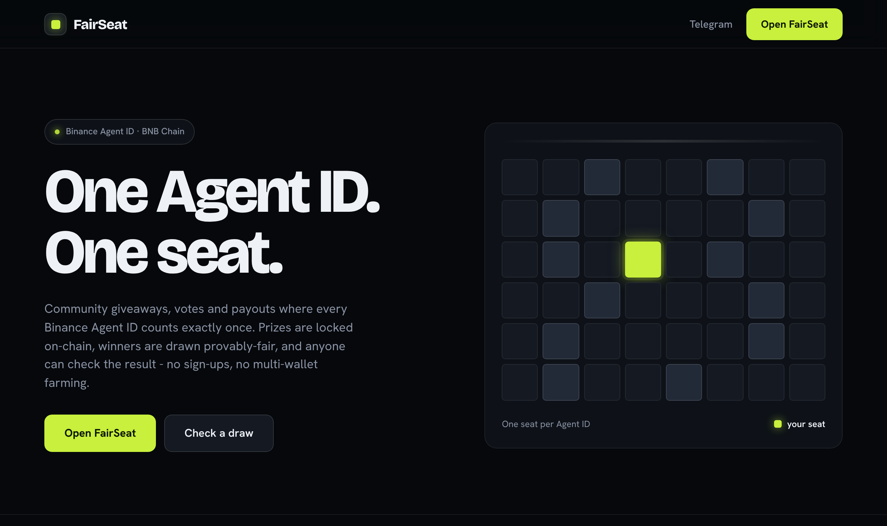
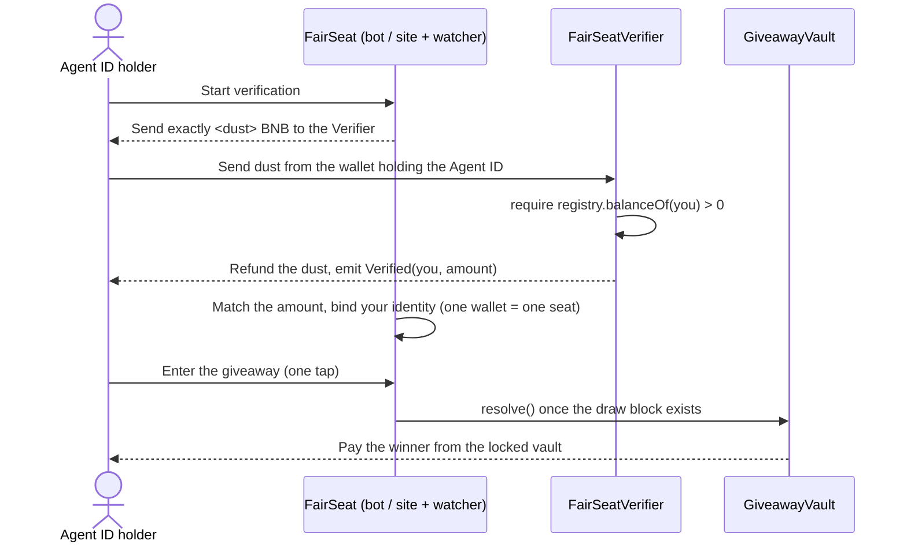
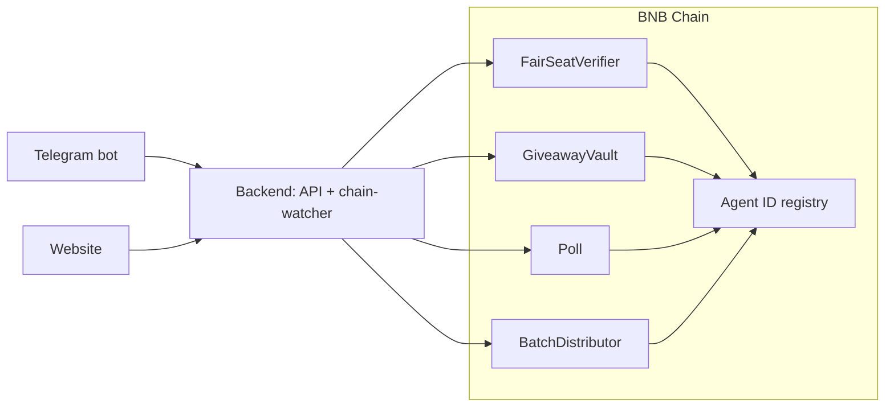

# FairSeat, one Agent ID, one seat

**Participation infrastructure for [Binance Agent ID](https://bscscan.com/address/0x60B9262456dE011F7d15a54CdD8c48bAaa8B022f) holders on BNB Chain.** Each Agent ID counts exactly once in giveaways, votes and payouts. Prizes are locked on-chain, winners are drawn provably-fair, and anyone can check the result. No sign-ups, no multi-wallet farming.

Built for the **Binance Wallet x BNB Chain Agent ID Hackathon**. Live on BNB Chain mainnet (chain 56).

**Try it:** [fairseat.185-7-81-139.sslip.io](https://fairseat.185-7-81-139.sslip.io) · **Telegram:** [@getfairseat_bot](https://t.me/getfairseat_bot)



## Why this exists

Online giveaways, airdrops and community votes share one weakness: identity. One person with fifty wallets takes fifty entries, fifty votes, fifty claims. Captchas, follower counts and snapshot tricks are gamed in minutes, so the reward flows to whoever farms the most addresses, not to the people a project actually wants to reach.

A **Binance Agent ID** changes the economics. It is **one per Binance account**, **non-transferable**, and lives on-chain as a soulbound ERC-721 you can only claim inside the Binance app. FairSeat uses it as a fair seat: one participation per Agent ID, checked on-chain every single time money or a vote moves. A room of fifty bot wallets collapses to one seat. Sybil-resistance comes from Binance KYC, so FairSeat does not claim to prove personhood, but it makes multi-wallet farming pointless and every outcome publicly checkable.

## What it does

| | |
| --- | --- |
| **Verify once** | Send one tiny transaction from your Binance AI wallet; FairSeat confirms you hold an Agent ID and links your account. No keys, no login, no wallet-connect, and the dust is refunded. After that, joining anything is one tap. |
| **Giveaways** | A host funds an on-chain vault that nobody, not even FairSeat, can withdraw early. Winners are chosen first-come, random, or split-equally, and paid automatically. A winner that cannot receive is skipped and their share returns to the host. |
| **Votes** | One Agent ID, one vote. The tally is public and on-chain, so it cannot be stuffed with fake wallets. |
| **Distribute** | Pay a whole list of addresses in a single transaction. Only Agent-ID holders are paid; anyone else is skipped and refunded in the same tx. |

Runs as a Telegram bot, a website, and on-chain contracts. One backend engine serves both surfaces, using a generic identity (`tg:<id>` or `web:<token>`) so the same rules apply everywhere.

## How it works



Every payout and vote calls `registry.balanceOf(address) > 0` against the real Agent ID registry, so only holders count. Giveaway funds live in the vault and can only leave to winners who hold an Agent ID or back to the host; there is no admin path that moves them. Random winners come from a **future block hash** with the entrant set fixed *before* that block exists, so the draw cannot be re-rolled and anyone can recompute it. The site's **Check a draw** page does exactly that, in your browser.

## Verifying your Agent ID

Verification is a plain on-chain transfer. There is no wallet-connect and no signing prompt; you just make a send you already know how to make. FairSeat gives you a verifier address and a unique tiny amount, matches your transaction by that amount, binds your seat, and refunds the dust. Every amount is kept to 8 decimal places or fewer so it is always typeable in the Binance wallet.

**Adding the verifier to your Binance Address Book** (so you can send to it in two taps):

1. Open the Binance app and go to your **Binance Wallet**.
2. Tap the **menu / dashboard icon at the top-right** of the wallet screen.
3. Scroll down and open **Address Book**.
4. Tap **Add address**, choose **BNB Chain (BNB Smart Chain)**, paste the FairSeat verifier address, give it a label like "FairSeat", and save.
5. Back in the wallet, **Send** BNB to that saved address, using the exact amount FairSeat shows you.


## Architecture



- **`contracts/`**: the four Solidity contracts, their Hardhat tests, and the deploy script. The money and the one-seat rule live here; nothing off-chain can override them.
- **`bot/`**: one TypeScript backend. The grammY Telegram bot, an HTTP API for the website, and a chain-watcher that reacts to on-chain events all share a single framework-independent service, so a giveaway behaves the same whether it was created in Telegram or on the web.
- **`web/`**: the website (Vite + React, hash-routed): the public landing page, the verify gate, the giveaway and poll pages, and the browser-side Check a draw recomputation.

The split is deliberate: the chain gives the hard guarantees (locked funds, one-seat checks, un-rollable draws), and the off-chain engine gives the friendly rules (scopes, access keys, tap-to-enter) without ever being able to touch the money.

## Facts

| | |
| --- | --- |
| Network | BNB Chain mainnet (chainId 56) |
| Agent ID registry | [`0x60B9262456dE011F7d15a54CdD8c48bAaa8B022f`](https://bscscan.com/address/0x60B9262456dE011F7d15a54CdD8c48bAaa8B022f) (Binance / SPACE ID, soulbound ERC-721) |
| FairSeatVerifier | [`0xa065A7F4b10Ef6895Ae38474DaD569daDc459E2B`](https://bscscan.com/address/0xa065A7F4b10Ef6895Ae38474DaD569daDc459E2B#code), verified |
| GiveawayVault | [`0xC5c13aED4762e556608E0A064c0F759b08d20292`](https://bscscan.com/address/0xC5c13aED4762e556608E0A064c0F759b08d20292#code), verified |
| Poll | [`0x45bBef44cDAabaB4ae3D730f22fb5Cc737eDA5cc`](https://bscscan.com/address/0x45bBef44cDAabaB4ae3D730f22fb5Cc737eDA5cc#code), verified |
| BatchDistributor | [`0x1d7Fda5578fc1b36Bd7A8542bEe44d3b6e033e39`](https://bscscan.com/address/0x1d7Fda5578fc1b36Bd7A8542bEe44d3b6e033e39#code), verified |
| Stack | Solidity 0.8.24, Hardhat, OpenZeppelin, Node 22 + TypeScript, grammY, ethers v6, Vite + React 18 |
| Tests | 24 contract tests + 9 backend tests passing ([`audit.md`](audit.md)) |
| Owner over funds | None (see [Security](#security-and-privacy)) |

### The contracts

| Contract | Role |
| --- | --- |
| `FairSeatVerifier` | Verify-once by a tiny self-send; checks the Agent ID, emits `Verified`, refunds the dust, reverts for non-holders. |
| `GiveawayVault` | Locks the prize; permissionless `resolve()`; first-come / random / split-equally payout to Agent-ID winners; leftover back to the host. |
| `Poll` | One Agent ID, one vote; public on-chain tally. |
| `BatchDistributor` | Pays a verified list in one transaction; non-holders skipped and refunded. |

The test-only `MockAgentIdRegistry` and `MockERC20` under `contracts/contracts/mocks/` are never deployed to mainnet; the deploy script uses the real registry on chain 56.

## Bot commands & API

**Telegram** (tap `/` for the menu): `/verify`, `/mystatus`, `/giveaway` (hosts), `/poll` (hosts), `/enter`, `/start`.

**HTTP API** (same backend, used by the site):

| Method | Path | Purpose |
| --- | --- | --- |
| `GET` | `/api/config` | Chain + contract addresses |
| `GET` | `/api/giveaways`, `/api/giveaways/:id` | Public giveaways |
| `POST` | `/api/verify/start`, `GET /api/verify/status` | Web verification session |
| `POST` | `/api/giveaways/:id/enter` | Enter a giveaway |
| `POST` | `/api/prepare`, `/api/polls/prepare` | Build a create-giveaway / create-poll transaction |
| `GET` | `/api/polls`, `/api/polls/:id`, `POST /api/polls/:id/vote` | Polls |
| `GET` | `/api/draw/:id` | Public draw data for recomputing winners |

## Security and privacy

- **No keys, ever.** FairSeat never asks for a private key, seed phrase or login, and never signs on your behalf. Every transaction is one you send and confirm in your own wallet.
- **No custody.** There is no owner that can move user funds. The only privileged role is an immutable `operator` on the vault and poll that can *only* submit off-chain-tap entrants and votes; it can never withdraw, mint, pause or take funds. Full disclosure: [`docs/OWNER-PERMISSIONS.md`](docs/OWNER-PERMISSIONS.md).
- **What is stored.** A local SQLite database holds identity-to-wallet bindings and verification sessions. No keys, no funds, no wallet sessions.
- **Audited internally.** An attacker-minded review of the contracts and backend, each finding fixed and covered by a regression test: [`audit.md`](audit.md). No Critical or High findings; not independently audited (see [Limitations](#limitations)).
- **Open and verified.** All four contracts are open-source and verified on BscScan (links in [Facts](#facts)).

## Run it locally

Requirements: Node 22+ and pnpm.

```bash
pnpm install
```

```bash
cd contracts && pnpm test
```

```bash
cd bot && cp .env.example .env
pnpm test
pnpm dev
```

```bash
cd web && pnpm dev
```

`.env` files and every database and key file are git-ignored; `.env.example` documents each variable. Deploying to BNB Chain, verifying on BscScan, and hosting the backend + site: [`docs/DEPLOY.md`](docs/DEPLOY.md).

## Repository layout

```
contracts/     Solidity contracts, Hardhat tests, deploy script
bot/           Backend: Telegram bot + HTTP API + chain-watcher
web/           Website (Vite + React)
docs/          ARCHITECTURE.md, DEPLOY.md, OWNER-PERMISSIONS.md, screenshots/
brand/         Logo
audit.md       Internal security audit
```

## Limitations

- **Sybil-resistance equals Binance KYC**, which is off-chain. FairSeat enforces one seat per Agent ID, but one-per-person rests on Binance KYC; it cannot stop someone who controls several real Binance accounts.
- **Randomness is block-hash based, not a VRF.** Good for community giveaways and fully recomputable; a block producer could bias a single block hash. The backend resolves promptly so the un-grindable path is the norm (`audit.md`, F-5).
- **Internally audited, not third-party audited.** Single reviewer; no formal verification or fuzzing.
- **Verification uses a unique dust amount** with no memo, so a pending amount is a per-user secret with a 60-minute window (`audit.md`, F-4).

## Credits and license

[MIT](LICENSE). Fonts: [Bricolage Grotesque](https://fonts.google.com/specimen/Bricolage+Grotesque) and [Hanken Grotesk](https://fonts.google.com/specimen/Hanken+Grotesk), both SIL Open Font License. Libraries: [OpenZeppelin](https://github.com/OpenZeppelin/openzeppelin-contracts), [Hardhat](https://hardhat.org), [ethers.js](https://github.com/ethers-io/ethers.js), [grammY](https://grammy.dev), [React](https://react.dev), [Vite](https://vitejs.dev), each under its own license. Agent ID registry: Binance / [SPACE ID](https://space.id).
