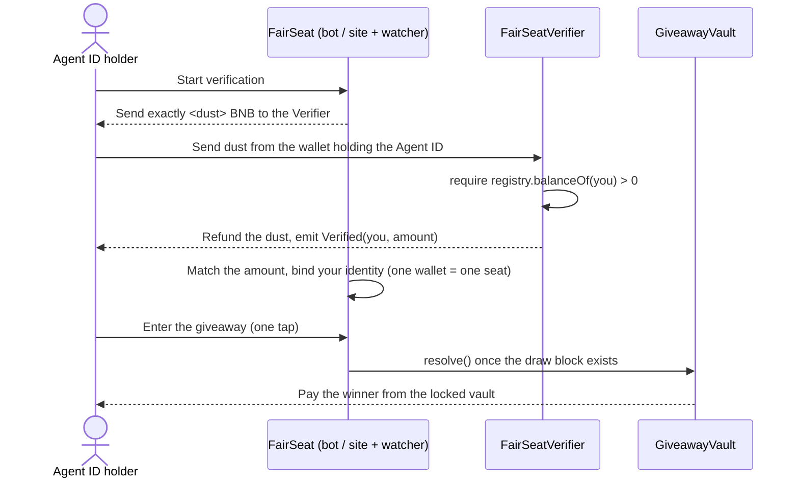
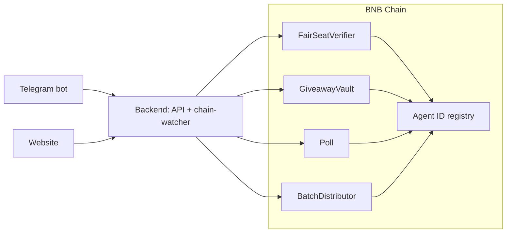

# FairSeat, one Agent ID, one seat

**Participation infrastructure for [Binance Agent ID](https://bscscan.com/address/0x60B9262456dE011F7d15a54CdD8c48bAaa8B022f) holders on BNB Chain.** Each Agent ID counts exactly once in giveaways, votes and payouts. Prizes are locked on-chain, winners are drawn provably-fair, and anyone can check the result. No sign-ups, no multi-wallet farming.

Built for the **Binance Wallet x BNB Chain Agent ID Hackathon**. Live on BNB Chain mainnet (chain 56).

**Try it:** [fairseat.185-7-81-139.sslip.io](https://fairseat.185-7-81-139.sslip.io) · **Telegram:** [@getfairseat_bot](https://t.me/getfairseat_bot)


## Facts

| | |
| --- | --- |
| Network | BNB Chain mainnet (chainId 56) |
| Agent ID registry | [`0x60B9…022F`](https://bscscan.com/address/0x60B9262456dE011F7d15a54CdD8c48bAaa8B022f) (soulbound ERC-721) |
| FairSeatVerifier | [`0xa065…9E2B`](https://bscscan.com/address/0xa065A7F4b10Ef6895Ae38474DaD569daDc459E2B#code), verified |
| GiveawayVault | [`0xC5c1…0292`](https://bscscan.com/address/0xC5c13aED4762e556608E0A064c0F759b08d20292#code), verified |
| Poll | [`0x45bB…A5cc`](https://bscscan.com/address/0x45bBef44cDAabaB4ae3D730f22fb5Cc737eDA5cc#code), verified |
| BatchDistributor | [`0x1d7F…3e39`](https://bscscan.com/address/0x1d7Fda5578fc1b36Bd7A8542bEe44d3b6e033e39#code), verified |
| Stack | Solidity 0.8.24, Hardhat, OpenZeppelin, Node 22 + TypeScript, grammY, ethers v6, Vite + React 18 |
| Tests | 24 contract + 9 backend passing ([`audit.md`](audit.md)) |
| Owner over funds | None (see Security) |

## Why

Crypto giveaways, airdrops and polls are broken by multi-wallet farming: one person with 50 wallets takes 50 entries, 50 votes, 50 claims. A Binance Agent ID is one per Binance account and non-transferable (a soulbound ERC-721). FairSeat uses it as a fair seat: one participation per Agent ID, checked on-chain every time money or a vote moves. Sybil-resistance comes from Binance KYC; FairSeat does not claim to prove personhood.

## What it does

| | |
| --- | --- |
| **Verify once** | Send one tiny transaction from your Binance AI wallet; FairSeat confirms you hold an Agent ID and links your account. No keys, no login, dust refunded. After that, joining is a tap. |
| **Giveaways** | A host funds an on-chain vault nobody can withdraw early. Winners by first-come, random, or split-equally, paid automatically. A winner that can't receive is skipped and their share returns to the host. |
| **Votes** | One Agent ID, one vote. The tally is public and on-chain. |
| **Distribute** | Pay a whole list in one transaction. Only Agent-ID holders are paid; anyone else is skipped and refunded in the same tx. |

Runs as a Telegram bot, a website, and on-chain contracts. One backend engine serves both surfaces (`tg:` and `web:` identities).

## How it works



Every payout and vote calls `registry.balanceOf(address) > 0`, so only holders count. Giveaway funds can only leave to winners who hold an Agent ID or back to the host; there is no admin path that moves them. Random winners come from a future block hash with the entrant set fixed before that block exists, so the draw can't be re-rolled and anyone can recompute it (the site's **Check a draw** page does this in your browser).


## Architecture



- **`contracts/`**: the four Solidity contracts, Hardhat tests, deploy script. The money and the one-seat rule live here.
- **`bot/`**: one TypeScript backend (grammY Telegram bot + HTTP API + chain-watcher); business logic is shared by both surfaces.
- **`web/`**: the website (Vite + React), landing page, verify gate, and the browser-side draw recomputation.

## Security

- **No keys, ever.** FairSeat never asks for a key, seed phrase or login, and never signs for you. Every transaction is one you send and confirm yourself.
- **No custody.** No owner can move user funds. The only privileged role is an immutable `operator` that can only submit off-chain-tap entrants/votes; it can never withdraw, mint, pause or take funds ([`docs/OWNER-PERMISSIONS.md`](docs/OWNER-PERMISSIONS.md)).
- **Stored:** a local SQLite file with identity-to-wallet bindings and verification sessions. No keys, no funds.
- **Audited internally,** not third-party ([`audit.md`](audit.md)). All four contracts are open-source and verified on BscScan.

## Run it locally

Requirements: Node 22+ and pnpm.

```bash
pnpm install
```

```bash
cd contracts && pnpm test
```

```bash
cd bot && cp .env.example .env
pnpm test
pnpm dev
```

```bash
cd web && pnpm dev
```

Deploying to BNB Chain and hosting: [`docs/DEPLOY.md`](docs/DEPLOY.md).

## Limitations

- Sybil-resistance equals Binance KYC, which is off-chain; it cannot stop someone running several real Binance accounts.
- Randomness is block-hash based, not a VRF: fully recomputable, but a block producer could bias one block hash.
- Internally audited only, single reviewer.

## License

[MIT](LICENSE). Fonts: Bricolage Grotesque and Hanken Grotesk (SIL OFL). Libraries: OpenZeppelin, Hardhat, ethers, grammY, React, Vite, each under its own license.
