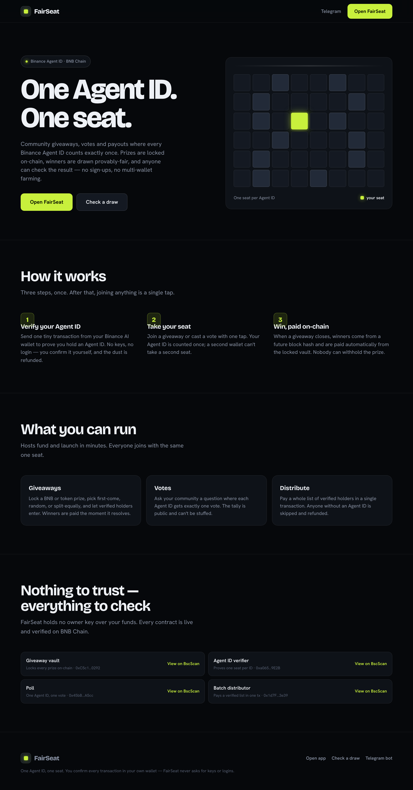
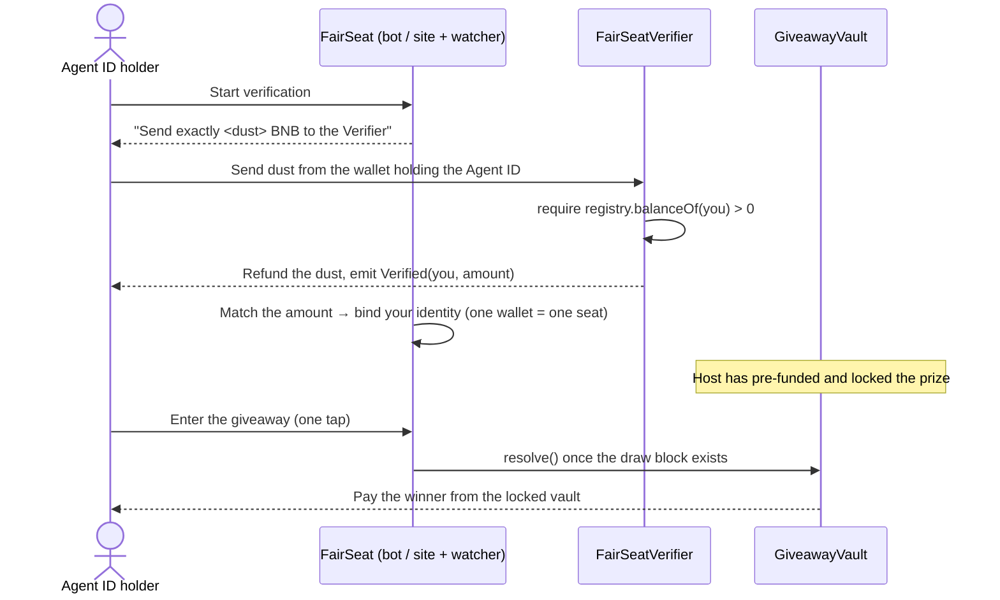
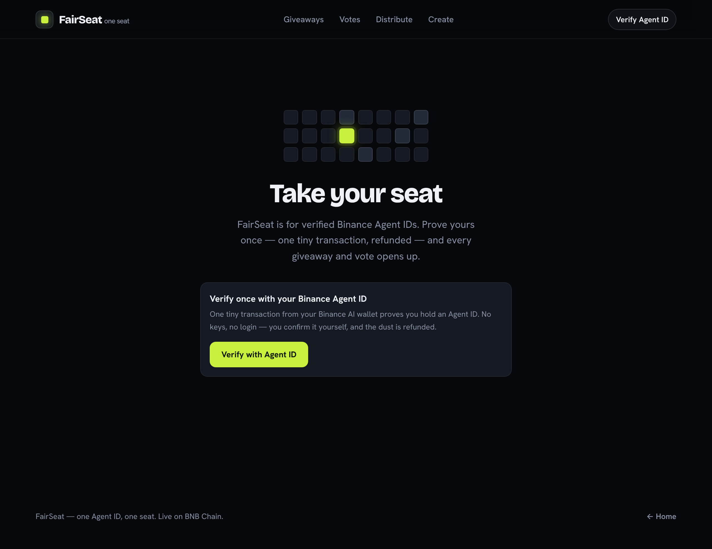
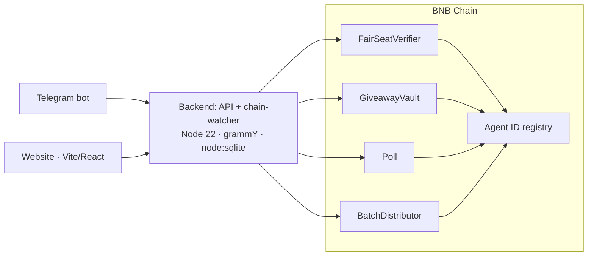

# FairSeat — one Agent ID, one seat

**Participation infrastructure for [Binance Agent ID](https://bscscan.com/address/0x60B9262456dE011F7d15a54CdD8c48bAaa8B022F) holders on BNB Chain.** Each Binance Agent ID counts exactly **once** in giveaways, votes and payouts — prizes are locked on-chain, winners are drawn provably-fair, and anyone can check the result. No sign-ups, no multi-wallet farming.

> Built for the **Binance Wallet × BNB Chain Agent ID Hackathon**. Live on BNB Chain mainnet (chain 56).

**Try it:** [fairseat.185-7-81-139.sslip.io](https://fairseat.185-7-81-139.sslip.io) · **Telegram bot:** [@getfairseat_bot](https://t.me/getfairseat_bot)



## Facts

| | |
| --- | --- |
| **Network** | BNB Chain mainnet (chainId 56) |
| **Agent ID registry** | [`0x60B9…022F`](https://bscscan.com/address/0x60B9262456dE011F7d15a54CdD8c48bAaa8B022F) (Binance / SPACE ID, soulbound ERC-721) |
| **FairSeatVerifier** | [`0xa065…9E2B`](https://bscscan.com/address/0xa065A7F4b10Ef6895Ae38474DaD569daDc459E2B#code) — verified ✓ |
| **GiveawayVault** | [`0xC5c1…0292`](https://bscscan.com/address/0xC5c13aED4762e556608E0A064c0F759b08d20292#code) — verified ✓ |
| **Poll** | [`0x45bB…A5cc`](https://bscscan.com/address/0x45bBef44cDAabaB4ae3D730f22fb5Cc737eDA5cc#code) — verified ✓ |
| **BatchDistributor** | [`0x1d7F…3e39`](https://bscscan.com/address/0x1d7Fda5578fc1b36Bd7A8542bEe44d3b6e033e39#code) — verified ✓ |
| **Stack** | Solidity 0.8.24 · Hardhat · OpenZeppelin · Node 22 + TypeScript · grammY · ethers v6 · Vite + React 18 |
| **Tests** | 24 contract tests + 9 backend tests passing — see [`audit.md`](audit.md) |
| **Owner over funds** | None — see [Security](#security-and-privacy) |

## Contents

- [Why this exists](#why-this-exists)
- [What it does](#what-it-does)
- [How it works](#how-it-works)
- [Verifying your Agent ID](#verifying-your-agent-id)
- [Bot commands & API](#bot-commands--api)
- [Architecture](#architecture)
- [Security and privacy](#security-and-privacy)
- [Run it locally](#run-it-locally)
- [Deploy](#deploy)
- [Extend it](#extend-it)
- [Repository layout](#repository-layout)
- [Limitations](#limitations)
- [Credits and license](#credits-and-license)

## Why this exists

Crypto giveaways, airdrops and polls are broken by multi-wallet farming: one person with 50 wallets takes 50 entries, 50 votes, 50 claims. The usual fixes — captchas, follower counts, snapshot tricks — are gamed in minutes.

A **Binance Agent ID** is **one per Binance account** and **non-transferable** (a soulbound ERC-721 you can only claim inside the Binance app). FairSeat uses it as a fair "seat": one participation per Agent ID, checked on-chain every time money or a vote moves. The result is a giveaway or poll that a room of 50 bots can't tilt, and whose outcome anyone can recompute for themselves.

## What it does

| | |
| --- | --- |
| **Verify once** | Send one tiny transaction from your Binance AI wallet; FairSeat confirms you hold an Agent ID and links your account. No keys, no login — you confirm it yourself, and the dust is refunded. After that, joining is a single tap. |
| **Giveaways** | A host funds an on-chain vault; nobody — not even FairSeat — can withdraw it early. Winners are chosen first-come, random, or split-equally, and paid automatically. A winner that can't receive is skipped and their share returns to the host. |
| **Votes** | One Agent ID, one vote. The tally is public and on-chain, so it can't be stuffed with fake wallets. |
| **Distribute** | Pay a whole list of addresses in one transaction. Only real Agent-ID holders are paid; anyone else is skipped and refunded in the same tx. |

Runs as a **Telegram bot**, a **website**, and **on-chain contracts** — one backend engine serves both surfaces (`tg:` and `web:` identities).

## How it works



**Why it's safe.** Every payout and vote calls `registry.balanceOf(address) > 0` against the real Agent ID registry, so only holders count. Giveaway funds live in the vault and can only leave to winners who hold an Agent ID or back to the host — there is no admin path that moves them. Random winners come from a **future block hash** with the entrant set fixed *before* that block exists, so the draw can't be re-rolled and anyone can recompute it. The site's **Check a draw** page does exactly that, in your browser.

## Verifying your Agent ID

Verification is a plain on-chain transfer — no wallet-connect, no signing prompt, nothing to approve beyond a send you make yourself. The bot and the site both walk you through adding the Verifier to your Address Book and sending the exact dust amount; FairSeat matches it and refunds it.



## Bot commands & API

**Telegram** (tap `/` to see the menu):

| Command | Does |
| --- | --- |
| `/verify` | Prove you hold a Binance Agent ID (DM, stays private) |
| `/mystatus` | Check your verification |
| `/giveaway` | Hosts: launch a locked, provably-fair giveaway |
| `/poll` | Hosts: start a one Agent ID, one vote poll |
| `/enter` | Enter the current giveaway |

**HTTP API** (same backend, used by the website):

| Method | Path | Purpose |
| --- | --- | --- |
| `GET` | `/api/config` | Chain + contract addresses |
| `GET` | `/api/giveaways` · `/api/giveaways/:id` | Public giveaways |
| `POST` | `/api/verify/start` · `GET /api/verify/status` | Web verification session |
| `POST` | `/api/giveaways/:id/enter` | Enter a giveaway |
| `POST` | `/api/prepare` · `/api/polls/prepare` | Build a create-giveaway / create-poll transaction |
| `GET` | `/api/polls` · `/api/polls/:id` · `POST /api/polls/:id/vote` | Polls |
| `GET` | `/api/draw/:id` | Public draw data for recomputing winners |

## Architecture



- **`contracts/`** — the four Solidity contracts, Hardhat tests and the deploy script. The money and the one-seat rule live here; nothing off-chain can override them.
- **`bot/`** — one TypeScript backend: the grammY Telegram bot, an HTTP API for the website, and a chain-watcher that reacts to on-chain events. Business logic is framework-independent and shared by both surfaces.
- **`web/`** — the website (Vite + React, hash-routed), including the public landing page, the verify gate, and the browser-side **Check a draw** recomputation.

## Security and privacy

- **No keys, ever.** FairSeat never asks for a private key, seed phrase or login, and never signs on your behalf. Every transaction is one you send and confirm in your own wallet.
- **No custody.** There is no owner that can move user funds. The only privileged role is an immutable `operator` on the vault and poll that can *only* submit off-chain-tap entrants/votes; it can never withdraw, mint, pause or take funds. Full disclosure: [`docs/OWNER-PERMISSIONS.md`](docs/OWNER-PERMISSIONS.md).
- **What's stored.** A local SQLite database holds the identity→wallet bindings and verification sessions. No keys, no funds, no wallet sessions.
- **Audited internally.** An attacker-minded review of the contracts and backend, with each finding fixed and covered by a regression test: [`audit.md`](audit.md). No Critical or High findings; not independently audited (see [Limitations](#limitations)).
- **Open and verified.** All four contracts are open-source and verified on BscScan (links in [Facts](#facts)).

## Run it locally

Requirements: **Node 22+** and **pnpm**.

```bash
pnpm install
```

```bash
cd contracts && pnpm test
```

```bash
cd bot && cp .env.example .env    # fill it in (addresses are in .env.example / the README)
pnpm test
pnpm dev
```

```bash
cd web && pnpm dev
```

`.env` files and every database and key file are git-ignored; `.env.example` documents each variable.

## Deploy

Deploying the contracts to BNB Chain, verifying them on BscScan, and hosting the backend + site: [`docs/DEPLOY.md`](docs/DEPLOY.md).

## Extend it

- **A new giveaway rule** (e.g. weighted draw): add a `Rule` to `GiveawayVault` and its recompute to `web/src/lib.ts` so draws stay verifiable.
- **A new surface** (e.g. Discord): reuse the `bot/src/service.ts` engine with a new `discord:<id>` identity prefix — the on-chain layer is unchanged.

## Repository layout

```
contracts/     Solidity contracts, Hardhat tests, deploy script
bot/           Backend: Telegram bot + HTTP API + chain-watcher
web/           Website (Vite + React)
docs/          ARCHITECTURE.md · DEPLOY.md · OWNER-PERMISSIONS.md · screenshots/
brand/         Logo
audit.md       Internal security audit
private/       Working notes & evidence (git-ignored)
```

## Limitations

- **Sybil-resistance equals Binance's KYC.** FairSeat enforces one seat per Agent ID, but one-per-person rests on Binance KYC, which is off-chain. It does not claim to prove personhood and cannot stop someone who controls several real Binance accounts.
- **Randomness is block-hash based, not a VRF.** Good for community giveaways and fully recomputable; a block producer could bias a single block hash. The backend resolves promptly so the un-grindable path is the norm (documented in `audit.md`, F-5).
- **Internally audited, not third-party audited.** Single-reviewer; no formal verification or fuzzing campaign.
- **Verification uses a unique dust amount.** It carries no memo, so a pending amount is a per-user secret with a 60-minute window (`audit.md`, F-4).

## Credits and license

- Libraries: [OpenZeppelin Contracts](https://github.com/OpenZeppelin/openzeppelin-contracts), [Hardhat](https://hardhat.org), [ethers.js](https://github.com/ethers-io/ethers.js), [grammY](https://grammy.dev), [React](https://react.dev), [Vite](https://vitejs.dev) — each under its own license.
- Fonts: [Bricolage Grotesque](https://fonts.google.com/specimen/Bricolage+Grotesque) and [Hanken Grotesk](https://fonts.google.com/specimen/Hanken+Grotesk), both SIL Open Font License.
- Agent ID registry: Binance / [SPACE ID](https://space.id) Agent ID on BNB Chain.
- License: [MIT](LICENSE).
